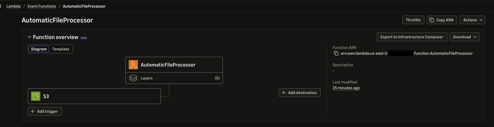
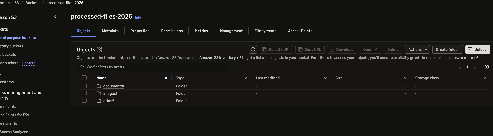
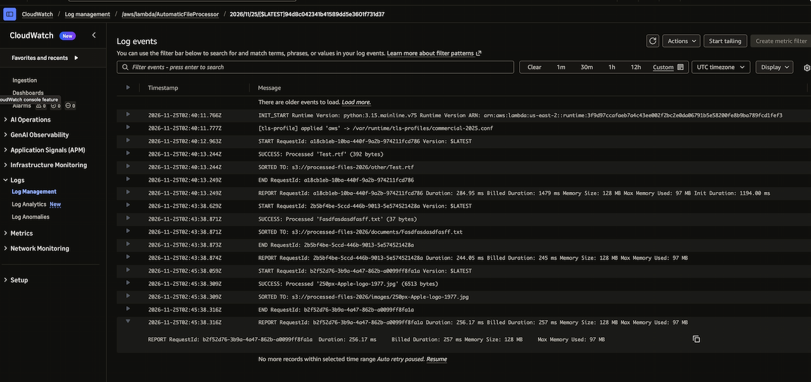

# AWS Automatic File Processor (Serverless)

A lightweight, event-driven tool built on AWS that automatically detects new file uploads in Amazon S3, reads the file details, and sorts each file into the right folder—without needing a server running 24/7.

## How It Works
1. A file is uploaded to the **incoming S3 bucket** (`raw-uploads`).
2. An **S3 Event Notification** automatically triggers an **AWS Lambda** function written in Python (`boto3`).
3. The function reads the file's name, size, and extension, then copies it into the **processed S3 bucket** under the matching folder:
   - `.jpg`, `.jpeg`, `.png`, `.gif` → `images/`
   - `.pdf`, `.docx`, `.txt`, `.csv` → `documents/`
   - Everything else → `other/`
4. Execution details, file sizes, and destination paths are automatically logged to **Amazon CloudWatch**.

## AWS Services Used
- **Amazon S3** (Source & destination storage + event trigger)
- **AWS Lambda** (Serverless Python compute)
- **AWS IAM** (Execution role & permissions)
- **Amazon CloudWatch** (Monitoring & execution logs)

## Key Design Decisions & Lessons Learned
- **Preventing Infinite Loops:** Instead of sorting files inside a single bucket (which can accidentally re-trigger Lambda in a loop and rack up charges), I separated incoming uploads and sorted outputs into two distinct S3 buckets.
- **Cold Start vs. Warm Start Performance:** CloudWatch logs showed an initial cold start of **1,194 ms** while AWS initialized the Python runtime, followed by warm executions of **244 ms** and **256 ms** using **97 MB** of the 128 MB allocated.
- **Security & Least Privilege:** For rapid lab testing, the Lambda execution role used `AmazonS3FullAccess` alongside `AWSLambdaBasicExecutionRole`. In a production environment, I would replace this with a custom inline IAM policy restricting `s3:GetObject` strictly to the source bucket ARN and `s3:PutObject` strictly to the destination bucket ARN.

## Proof of Execution

### Lambda Architecture & Trigger

### Auto-Sorted S3 Folders

### CloudWatch Execution Logs
Verified across three file types (`.rtf` → `other/`, `.txt` → `documents/`, `.jpg` → `images/`):

